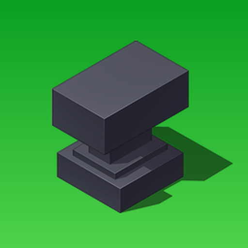

<div align="center">
  
  <h1>Bedrock Builder</h1>
  <p>Build tools for Minecraft Bedrock add-ons.</p>
  <p>
    <a href="https://www.npmjs.com/package/@aplok/bedrock-builder"></a>
    <a href="https://nodejs.org/"></a>
    <a href="LICENSE"></a>
    <a href="https://discord.com/invite/PppEgBdss4"></a>
  </p>
  <p>
    <a href="https://bedrock.trenbankai.dev/">Site</a>
    ·
    <a href="https://bedrock.trenbankai.dev/docs/">Docs</a>
    ·
    <a href="https://bedrock.trenbankai.dev/docs/getting-started/">Getting Started</a>
    ·
    <a href="https://bedrock.trenbankai.dev/docs/reference/cli/">CLI Reference</a>
  </p>
</div>

`bb` is a Node.js build tool for Bedrock add-ons. It bundles your scripts with esbuild, copies both packs into `dist/`, deploys to your local game install, and builds the `.mcaddon` you publish.

## What it does

- Create a workspace for a Bedrock add-on: a behavior pack, a resource pack, optional TypeScript, and a `dist/` folder you keep out of version control.
- Generate items, blocks, entities, recipes, loot, sounds, and more.
- Build scripts and pack files into a clean `dist/`, and only rebuild what changed.
- Run once, or watch the project and redeploy on every change.
- Validate the config, manifests, references, icons, languages, and output.
- Ship a release build as a `.mcaddon`.
- Extend the pipeline with your own processors. Format codecs stay out of core.

## Install

```bash
npm install --save-dev @aplok/bedrock-builder
```

The package provides both `bb` and `bedrock-builder` binaries. They are aliases for the same CLI.

## Start a project

```bash
bb init my-addon
cd my-addon
npm install
bb check
bb build
bb run --watch
```

For a release:

```bash
bb ship
```

## Project layout

```text
my-addon/
├─ bedrock.config.json
├─ package.json
├─ tsconfig.json
├─ src/
│  └─ main.ts
├─ packs/
│  ├─ BP/                 behavior pack
│  └─ RP/                 resource pack
└─ dist/                  generated output, normally gitignored
```

`config.json` is also supported. The generated project uses the standard project shape:

```json
{
  "type": "minecraftBedrock",
  "name": "my-addon",
  "authors": ["you"],
  "targetVersion": "1.21.0",
  "packs": {
    "behaviorPack": "packs/BP",
    "resourcePack": "packs/RP"
  },
  "bb": {
    "version": "1.0.0",
    "entry": "src/main.ts",
    "out": "dist",
    "deploy": {
      "target": "retail"
    }
  }
}
```

The entry can be TypeScript or JavaScript. If omitted, `bb` probes `src/main.ts` and then `src/main.js`. `bb.version` takes precedence over the project package version.

## Daily commands

| Command                                | Purpose                                            |
| -------------------------------------- | -------------------------------------------------- |
| `bb init`                              | Create a project.                                  |
| `bb new --list`                        | List all generator types.                          |
| `bb new item ruby`                     | Generate one resource and its linked files.        |
| `bb build`                             | Create development output.                         |
| `bb build --release`                   | Create minified release output without sourcemaps. |
| `bb run`                               | Build and deploy once.                             |
| `bb run --watch`                       | Rebuild and deploy on changes.                     |
| `bb check`                             | Validate the project.                              |
| `bb harness --strict`                  | Validate references and treat warnings as errors.  |
| `bb ship`                              | Build and create a `.mcaddon`.                     |
| `bb clean`                             | Remove output and cache.                           |
| `bb diff`                              | Show changes since the previous build.             |
| `bb ext`                               | Inspect configured extensions.                     |
| `bb ext --install`                     | Install extension dependencies locally.            |
| `bb manifest`                          | Rewrite pack UUIDs and links.                      |
| `bb version 1.1.0`                     | Update the project version.                        |
| `bb update`                            | Update deps plus the server manifest version.      |
| `bb completion [shell]`                | Print shell completions.                           |
| `bb import [dir]`                      | Adopt a pack folder into a bb project.             |
| `bb publish --bump minor --tag --push` | Run the release workflow.                          |

Most build commands accept `--json`. Add `--typecheck` to `build` or `ship` to run the project TypeScript check first.

## Generators

Use `bb new <type> [name]` to write the Bedrock files for one feature and update the registries that point at them. See the full list:

```bash
bb new --list
bb new item ruby
bb new weapon fire_sword --mode 3d
bb new block glow_block --light 12
bb new recipe ruby_sword --ingredients minecraft:stick,minecraft:diamond
```

Generators are safe to rerun. Identical files are skipped, registry entries are merged, and a conflict stops the run unless you pass `--force`. Some generators also write the related recipe, loot, or equipment file.

## Extensions

Extensions are listed in your project config. Core ships generic processor hooks. Format-specific work lives in the extension that needs it.

```json
{
  "bb": {
    "extensions": ["json-cleaner"]
  }
}
```

The loader looks in relative paths, project `node_modules`, `.builder/extensions`, the global extension directory, then the repo samples, in that order. An extension that is missing or fails to load logs a warning and is skipped. The build continues.

An extension can carry `extension.json` for builder metadata and `package.json` for npm metadata and dependencies. Install its dependencies into its own folder:

```bash
bb ext --install
```

Bundled samples are `emissive-fixer`, `json-cleaner`, `spawn-egg-generator`, and `lang-gap-filler`. They are examples and are not included in the npm package.

## Deployment

The default `retail` target finds the usual Bedrock installs. On Windows, `preview` covers the Preview and Store Beta builds. Point `custom` at a game directory when your install lives somewhere else:

```json
{
  "bb": {
    "deploy": {
      "target": "custom",
      "customPath": "C:/path/to/com.mojang"
    }
  }
}
```

## API

The package also ships JavaScript and TypeScript APIs for builds, generators, validation, and extensions:

```typescript
import { build, loadConfig } from "@aplok/bedrock-builder";

const config = await loadConfig("./bedrock.config.json");
await build(config, { release: false });
```

Media codecs are not exported by core. Install an extension for those formats.

## Requirements

- Node.js 20.19 or newer.
- Minecraft Bedrock for local deployment.

## Security notes

Report a vulnerability privately, see [SECURITY.md](SECURITY.md). Do not open a public issue.

`bb` is a build tool, so it reads and writes files, spawns a few local tools, and reads some environment variables. It sends no network requests itself. Here is what each one touches:

- **Filesystem.** Reading packs and writing `dist/` is the core job (`src/copier.ts`, `src/files/io.ts`, `src/files/tree.ts`). `bb` never reads outside the project directory, the deploy target, and the configured extension directories.
- **Shell.** Only fixed local tools are spawned, always with argument arrays, never shell strings:
  - `npm view` / `npm install` during `bb init` (`src/commands/init.ts`).
  - `npm install --ignore-scripts` into the extension folder during `bb ext --install` (`src/pipeline/loader.ts`).
  - `git init`, `git tag`, `git push` during `bb init` / `bb publish` (`src/commands/init.ts`, `src/commands/publish.ts`).
  - the project's own `tsc` for `--typecheck` and type watching (`src/typecheck.ts`, `src/typewatch.ts`).
- **Environment variables.** Only non-secret configuration is read: `NO_COLOR` / `TERM` for color output (`src/colors.ts`), `CI` / `GITHUB_ACTIONS` to disable progress output (`src/commands/create.ts`, `src/commands/pack.ts`), `LOCALAPPDATA` and platform home variables to locate the game folder (`src/paths.ts`), and `BB_PROD` for the production build (`scripts/build.mjs`). No tokens or credentials are read.
- **Network.** The core package performs no network access. The one exception is `bb init`, which runs `npm view <dep> version` to suggest a current dependency range and falls back to a local default offline (`src/commands/init.ts`).
- **Install scripts.** `bb ext --install` runs `npm install --ignore-scripts --no-audit --no-fund` inside the extension directory, so extension dependencies cannot run install scripts. The core package itself has no install script.
- **Dependencies.** Two runtime dependencies: `chokidar` for file watching and `esbuild` for bundling. Colors, prompts, zip writing, and the build script live in this repo (`src/colors.ts`, `src/prompts.ts`, `src/pack/zip.ts`, `scripts/build.mjs`) instead of coming from packages.

## Documentation

- [Website](https://bedrock.trenbankai.dev/)
- [Getting started](https://bedrock.trenbankai.dev/docs/getting-started/)
- [CLI reference](https://bedrock.trenbankai.dev/docs/reference/cli/)
- [Configuration](https://bedrock.trenbankai.dev/docs/reference/config/)
- [API reference](https://bedrock.trenbankai.dev/docs/reference/api/)

## License

zlib License. See [LICENSE](LICENSE).
